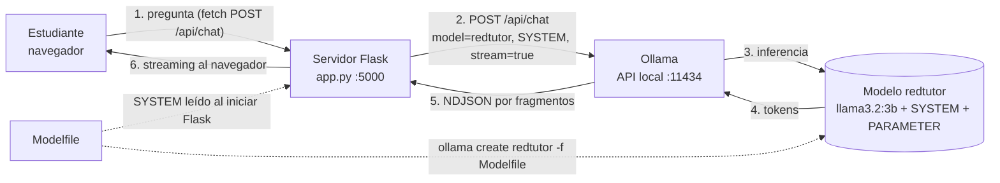

# RedTutor IA — Tutor local de fundamentos de redes

Evaluación 3 · Aplicaciones de Inteligencia Artificial · INACAP
Integrantes: Patricio Arias, Sebastián Urrutia, Agustín Richard · Profesor: Juan Mir

RedTutor IA es un asistente que corre **100 % local** con [Ollama](https://ollama.com). Parte del modelo
`llama3.2:3b` y se especializa mediante un **Modelfile** (instrucciones `SYSTEM` + `PARAMETER`) para
enseñar fundamentos de redes: OSI/TCP-IP, IPv4 y máscaras, router/switch/AP, TCP/UDP/DHCP/DNS/ICMP y
diagnóstico con `ping`, `ipconfig` y `tracert`. Una aplicación web en Flask permite usarlo desde el
navegador y compararlo lado a lado con el modelo base.

---

## 1. Estructura del proyecto

```
redtutor/
├── Modelfile                 # Definición del modelo especializado (FROM + PARAMETER + SYSTEM)
├── app.py                    # Backend Flask: interfaz + /api/chat + /api/compare + /api/health
├── requirements.txt          # flask, requests
├── templates/index.html      # Interfaz de chat
├── static/style.css          # Estilos (modo claro/oscuro, responsive)
├── static/app.js             # Lógica: streaming, Markdown, modo comparar, estado de Ollama
├── pruebas/experimentos.py   # Experimentos de parámetros y comparación base vs RedTutor
├── pruebas/resultados/       # Aquí se guardan los .md y .csv generados
├── GUION_VIDEO.md            # Guion del video (< 12 min)
└── README.md                 # Esta guía
```

## 2. Arquitectura y funcionamiento



Versión ASCII (por si el visor no muestra Mermaid):

```
 ┌──────────────┐  HTTP POST /api/chat   ┌───────────────┐  HTTP POST + SYSTEM     ┌──────────────┐
 │  Navegador   │ ─────────────────────▶ │  Flask (app)  │ ─────────────────────▶ │    Ollama    │
 │ HTML/CSS/JS  │ ◀───────────────────── │  :5000        │ ◀───────────────────── │   :11434     │
 └──────────────┘   respuesta streaming  └───────────────┘   NDJSON (stream)      └──────────────┘

 Modelfile ──SYSTEM al iniciar Flask──▶ Flask ──pregunta + SYSTEM──▶ Ollama
 Modelfile ──ollama create──▶ modelo "redtutor" (SYSTEM + PARAMETER)
```

**Cómo funciona el flujo**

1. El estudiante escribe en la web (o pulsa una pregunta sugerida). `app.js` envía la pregunta y el
   historial de la sesión a `POST /api/chat` de Flask.
2. Flask valida la pregunta (no vacía, máx. 2000 caracteres). Los saludos simples reciben una respuesta
   cordial; preguntas fuera del tema reciben una redirección fija, ambas sin llamar a Ollama. Para las
   consultas de redes, envía `model: "redtutor"`, `stream: true` y las instrucciones `SYSTEM` leídas
   directamente desde `Modelfile`. Así la web aplica el alcance definido aunque el modelo local se haya
   creado antes de la última edición.
3. Ollama carga el modelo en RAM/GPU (la primera vez demora más) y va generando tokens.
4. Flask reenvía cada fragmento al navegador como NDJSON (`{"delta": "..."}`) y al final envía
   `{"done": true, "seconds": ...}`.
5. `app.js` va renderizando el Markdown (títulos, listas, tablas, bloques de código) a medida que llega.
6. En **modo comparar**, Flask consulta el modelo base sin instrucciones personalizadas. Si la pregunta
   es ajena a redes, muestra la respuesta del modelo base y el rechazo fijo de RedTutor; si es sobre
   redes, consulta también `redtutor` con el `SYSTEM` leído desde `Modelfile`. Muestra ambas respuestas
   lado a lado con tiempo y cantidad de palabras.
7. Si Ollama está apagado, el modelo no existe o hay timeout, Flask devuelve un mensaje claro
   (por ejemplo: *"El modelo 'redtutor' no existe en Ollama. Créalo con: ollama create redtutor -f Modelfile"*).

No hay base de datos: el historial vive solo en la pestaña del navegador y se borra con **Limpiar**.

## 3. Requisitos

| Requisito | Detalle |
|---|---|
| Sistema | Windows 10/11 (también funciona en macOS/Linux) |
| RAM | 8 GB mínimo (el modelo ocupa ~2 GB) |
| Disco | ~3 GB libres |
| Ollama | Versión actual desde https://ollama.com/download |
| Python | 3.10 o superior (marcar "Add Python to PATH" al instalar) |

## 4. Instalación paso a paso (Windows)

### 4.1 Instalar Ollama
1. Descargar `OllamaSetup.exe` desde https://ollama.com/download y ejecutarlo.
2. Al terminar, Ollama queda corriendo en segundo plano (ícono de llama en la barra de tareas).
3. Abrir **PowerShell** y verificar:
   ```powershell
   ollama --version
   ```

### 4.2 Descargar el modelo base
```powershell
ollama pull llama3.2:3b
ollama run llama3.2:3b "¿Cuál es la diferencia entre un router y un switch?"
```
La segunda línea sirve como **evidencia del modelo base sin personalizar** (guardar captura).

### 4.3 Crear el modelo especializado
Desde la carpeta del proyecto (donde está el `Modelfile`):
```powershell
cd C:\ruta\a\redtutor
ollama create redtutor -f Modelfile
ollama list
ollama show redtutor --modelfile
```
- `ollama create` debe terminar en `success`.
- `ollama list` debe mostrar `redtutor:latest` y `llama3.2:3b`.
- `ollama show redtutor --modelfile` muestra el SYSTEM y los PARAMETER aplicados.

La aplicación web lee y aplica el `SYSTEM` actualizado al iniciarse; no es necesario recrear el modelo
para que la interfaz use las instrucciones vigentes. Para que los cambios también se apliquen al ejecutar
`ollama run redtutor` directamente o al usar `pruebas/experimentos.py`, vuelve a ejecutar
`ollama create redtutor -f Modelfile`.

### 4.4 Probar en la terminal
```powershell
ollama run redtutor
>>> ¿Qué significa una dirección IPv4 con máscara /24?
>>> ¿Me das una receta de queque?        # debe redirigir cortésmente a redes
>>> /bye
```
También se puede probar un parámetro en caliente dentro de `ollama run`:
```
>>> /set parameter temperature 1.0
>>> ¿Qué significa una dirección IPv4 con máscara /24?
```

### 4.5 Levantar la aplicación web
```powershell
python -m venv .venv
.\.venv\Scripts\Activate.ps1        # si PowerShell lo bloquea: Set-ExecutionPolicy -Scope CurrentUser RemoteSigned
pip install -r requirements.txt
python app.py
```
Abrir **http://localhost:5000**. El indicador superior debe decir **"Ollama conectado"**.

Variables opcionales (antes de `python app.py`):
```powershell
$env:OLLAMA_HOST="http://localhost:11434"
$env:REDTUTOR_MODEL="redtutor"
$env:BASE_MODEL="llama3.2:3b"
$env:PORT="5000"
```

### 4.6 Usar la interfaz
- Pulsar cualquiera de las **3 preguntas sugeridas** o escribir una propia (Enter envía, Shift+Enter salto de línea).
- La respuesta aparece en streaming con indicador **"RedTutor está pensando…"**, y al final el tiempo y las palabras.
- Activar **"Comparar con modelo base"** para ver `llama3.2:3b` vs `redtutor` lado a lado.
- **Limpiar** reinicia la conversación (el modelo deja de recordar lo anterior).

## 5. Experimentos de parámetros

Con Ollama abierto y ambos modelos instalados:
```powershell
python pruebas/experimentos.py --dry-run          # muestra el plan, no consulta
python pruebas/experimentos.py                    # corre todo (≈ 15 consultas)
python pruebas/experimentos.py --repeticiones 2   # repite cada prueba (consistencia)
python pruebas/experimentos.py --solo parametros  # solo el barrido de parámetros
```

Qué hace:
- **Comparación:** las 3 preguntas de prueba en `llama3.2:3b` y en `redtutor`, ambos con los mismos
  parámetros de generación (así la diferencia se debe al SYSTEM).
- **Barridos sobre `redtutor`** con la pregunta del /24, cambiando un parámetro por vez y dejando el
  resto en la configuración final (`temperature 0.3, top_p 0.9, repeat_penalty 1.1`):
  - `temperature`: 0.1, 0.3, 0.7, 1.0
  - `top_p`: 0.5, 0.9
  - `repeat_penalty`: 1.0, 1.1, 1.3
- Mide **tiempo**, **tokens**, **tokens/s**, **palabras**, **diversidad léxica**, si respeta las secciones
  del formato (Definición / Ejemplo / Resumen), si incluye código o tabla, si menciona los 254 hosts y si
  respondió en español.

Archivos generados en `pruebas/resultados/`:

| Archivo | Contenido | Dónde va en el informe |
|---|---|---|
| `comparacion.md` / `.csv` | Respuestas completas base vs RedTutor | Sección 11 (comparación) |
| `temperatura.md` | Respuestas con cada temperature | Sección 10.2 |
| `top_p.md` | Respuestas con cada top_p | Sección 10.3 |
| `repeat_penalty.md` | Respuestas con cada repeat_penalty | Sección 10.4 |
| `parametros.csv` | Todas las corridas de parámetros | Anexo |
| `resumen.md` | Tablas resumen listas para pegar | Secciones 10 y 11 |
| `rubrica_puntajes.csv` | Plantilla 1–5 para puntuar a mano | Sección 11.2 |

Los CSV usan `;` y UTF-8 con BOM para abrirse directo en Excel en español.
Los indicadores automáticos **no** reemplazan la evaluación del grupo: los puntajes 1–5 se asignan leyendo las respuestas.

## 6. Capturas de evidencia (Parte 4 del enunciado / criterio 6 de la rúbrica)

| # | Captura | Comando / pantalla | Demuestra |
|---|---|---|---|
| 1 | Versión de Ollama | `ollama --version` | Entorno instalado (criterio 1) |
| 2 | Descarga del base | `ollama pull llama3.2:3b` | Modelo base disponible |
| 3 | Modelfile abierto | VS Code / Bloc de notas con el `Modelfile` | Diseño SYSTEM + PARAMETER (criterio 2) |
| 4 | Creación del modelo | `ollama create redtutor -f Modelfile` → `success` | **Modelo creado correctamente** |
| 5 | Modelo disponible | `ollama list` (se ve `redtutor:latest`) | **Modelo disponible para su uso** |
| 6 | Configuración aplicada | `ollama show redtutor --modelfile` | Parámetros efectivos |
| 7 | Respuesta en terminal | `ollama run redtutor` + pregunta /24 | **Responde desde la terminal** |
| 8 | Pregunta fuera de tema | `ollama run redtutor` + "receta de queque" | Rol acotado (criterio 5) |
| 9 | Base en terminal | `ollama run llama3.2:3b` + misma pregunta | Punto de comparación |
| 10 | Flask corriendo | Terminal con `python app.py` | Backend activo |
| 11 | Web con respuesta | Navegador http://localhost:5000, pregunta P1 | **Responde desde la interfaz web** |
| 12 | Modo comparar P1 | Web, "Comparar con modelo base" | Diferencia apreciable (Parte 5) |
| 13 | Modo comparar P2 | Ídem pregunta /24 | Parte 5 |
| 14 | Modo comparar P3 | Ídem pregunta sin conexión | Parte 5 |
| 15 | Manejo de error | Cerrar Ollama → indicador "Ollama apagado" y mensaje de error | Robustez / usabilidad |
| 16 | Experimentos | Terminal con `python pruebas/experimentos.py` terminado | Experimentación (criterio 3) |
| 17 | Resultados | `pruebas/resultados/resumen.md` abierto | Datos para el análisis |

Recomendación: tomar las capturas con `Win + Shift + S` y nombrarlas `01_ollama_version.png`, `02_pull.png`, etc.

## 7. Solución de problemas

| Síntoma | Causa probable | Solución |
|---|---|---|
| Web muestra "Ollama apagado" | Ollama no está corriendo | Abrir la app Ollama o ejecutar `ollama serve` |
| "El modelo 'redtutor' no existe" | No se creó el modelo | `ollama create redtutor -f Modelfile` en la carpeta del proyecto |
| "El modelo 'llama3.2:3b' no existe" | No se descargó el base | `ollama pull llama3.2:3b` |
| `ollama create` falla con "no such file" | Terminal en otra carpeta | `cd` a la carpeta donde está `Modelfile` |
| Primera respuesta muy lenta / timeout | Se está cargando el modelo en memoria | Esperar y reintentar; subir `$env:OLLAMA_TIMEOUT="300"` |
| `python` no se reconoce | Python no está en el PATH | Reinstalar marcando "Add to PATH" o usar `py app.py` |
| `Activate.ps1` bloqueado | Política de ejecución | `Set-ExecutionPolicy -Scope CurrentUser RemoteSigned` |
| Puerto 5000 ocupado | Otro programa lo usa | `$env:PORT="5050"; python app.py` |
| Respuestas en inglés | Se está usando el modelo base | Verificar que el indicador y `REDTUTOR_MODEL` digan `redtutor` |
| Cambié el Modelfile y no se nota | No se recreó el modelo | Volver a correr `ollama create redtutor -f Modelfile` |

## 8. Documento de referencia

- Bonaventure, O. *Computer Networking: Principles, Protocols and Practice*. Saylor Foundation /
  Université catholique de Louvain. Licencia CC BY. Open Textbook Library:
  https://open.umn.edu/opentextbooks/textbooks/352
- Complementos normativos: RFC 1918 (direcciones privadas) https://www.rfc-editor.org/rfc/rfc1918 ,
  RFC 791 (IPv4) https://www.rfc-editor.org/rfc/rfc791 y RFC 792 (ICMP) https://www.rfc-editor.org/rfc/rfc792 .

La sección "Conocimiento de referencia" del `SYSTEM` condensa los puntos de estos documentos que el
modelo debe respetar (capas, PDU, cálculo de hosts, rangos privados, ICMP/ping/tracert). El informe
incluye la tabla documento → instrucción.
